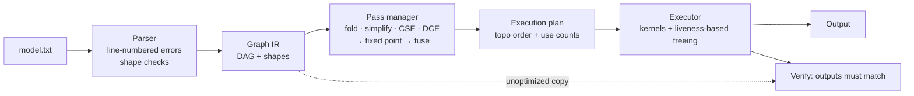
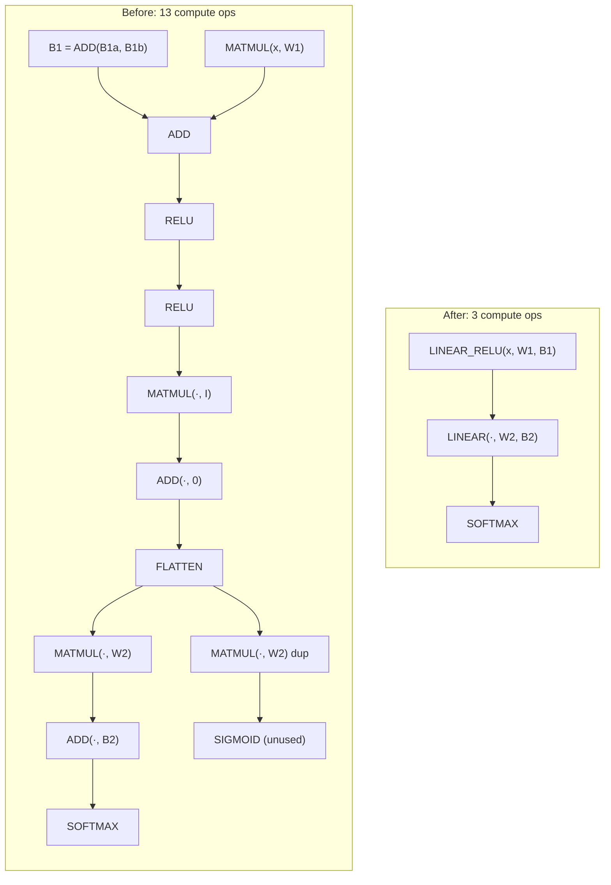

# TinyNNC: a tiny neural-network compiler in C

TinyNNC compiles a small text description of a neural network into a graph IR, optimizes it
with classic compiler passes (constant folding, algebraic simplification, CSE, dead code
elimination and operator fusion), and runs it with a runtime that frees each buffer once
its last consumer has run. Every optimization is checked to produce **the same output** as the
unoptimized graph, and the whole thing is checked against an independent NumPy implementation.

C11, standard library only: about 2.3k lines of compiler/runtime code plus 1.6k lines of tests and benchmarks. Zero warnings with `-Wall -Wextra -Wpedantic`.
Clean under AddressSanitizer, UBSan and macOS `leaks`.

## Pipeline



## Before / after: `examples/redundant.txt`

A 2-layer MLP written with redundant ops of the kind a naive exporter produces. This is real
output of `./tinynnc examples/redundant.txt --opt all --dump-ir --verify`:

```
== optimization passes (2 rounds) ==
  constant folding      : 1 nodes folded
  algebraic simplify    : 4 nodes rewritten
  common subexpr elim   : 1 nodes merged
  dead code elimination : 5 nodes removed
  operator fusion       : 3 ops fused away
                                       before        after
  compute ops                              13            3
  live nodes (incl. consts)                21            8
  estimated FLOPs                         308          158
  activation bytes (no reuse)             360           80
  constant bytes                          236          140
== IR after optimization ==
  %7   r1         = LINEAR_RELU(x, W1, B1)             [2x4]
  %18  a2         = LINEAR(r1, W2, B2)                 [2x3]
  %20  y          = SOFTMAX(a2)                        [2x3]   <- output
verify: max |optimized - unoptimized| = 0 -> PASS
```



Graphviz versions are in [`docs/redundant_before.dot`](docs/redundant_before.dot) and
[`docs/redundant_after.dot`](docs/redundant_after.dot). Render them with `dot -Tpng file.dot -o file.png`.

## Results

Measured on an Apple M2 (single thread), Apple clang 21, `-O2`. Weights are seeded and
random, and inputs are uniform in [-1, 1). Every row below comes from
[`docs/RESULTS.md`](docs/RESULTS.md), which `make bench` regenerates. The optimized output
differed from the unoptimized output by **exactly 0** in every row.

| Model (batch 32) | Passes | Compute ops | Est. FLOPs | Peak activation mem | Time (mean ± std) | Speedup |
|---|---|---:|---:|---:|---:|---:|
| 256×512×256, redundant ops | none | 14 | 50.5 M | 199,680 B | 2019.7 ± 39.5 µs | 1.00× |
| 256×512×256, redundant ops | all  | 2  | 16.8 M | 98,304 B  | 626.9 ± 14.6 µs | **3.22×** |
| 64×128×64, redundant ops   | none | 14 | 3.18 M | 49,920 B  | 139.1 ± 10.2 µs | 1.00× |
| 64×128×64, redundant ops   | all  | 2  | 1.06 M | 24,576 B  | 39.2 ± 3.9 µs | **3.55×** |
| 256×512×256, clean         | none | 5  | 16.8 M | 131,072 B | 627.7 ± 21.4 µs | 1.00× |
| 256×512×256, clean         | all (fusion) | 2 | 16.8 M | 98,304 B | 629.1 ± 34.9 µs | 1.00× |
| 64×128×64, clean, batch 1  | none | 5  | 33 K   | 1,024 B   | 1.71 ± 0.77 µs | 1.00× |
| 64×128×64, clean, batch 1  | all (fusion) | 2 | 33 K | 768 B | 1.46 ± 0.59 µs | 1.17× |

**Liveness-based freeing** (same runs): on the redundant 256×512×256 model, peak activation
memory falls from 658,432 B when every intermediate is kept to 199,680 B (−70%) when each
buffer is freed after its last use. After all passes it is 98,304 B.

**What the numbers mean**
- The large speedups on the redundant models come from **removing work**. CSE and DCE delete the
  duplicated matmul in each layer, and simplification deletes the multiply by a 512×512 identity
  matrix. Together they cut estimated FLOPs by 3.0× (50.5 M → 16.8 M).
- On clean MLPs, **fusion** turns 5 ops into 2 and cuts peak activation memory by 25%. Run time
  only changes measurably at batch 1 (1.17×), where per-op overhead matters. At batch 32 the
  O(M·K·N) matmul dominates and the saved O(M·N) elementwise passes are within noise. A
  faster matmul (tiling, SIMD, threads) would make the elementwise share, and so the fusion
  win, larger. That is future work.
- Passes that find nothing to do (for example `fold` on a clean model) measure 0.95–1.04×, which
  shows the noise level of the measurement.

## Build, run, test

```bash
make            # builds ./tinynnc, the library and the tests (zero warnings)
make test       # 63 C unit/equivalence tests + NumPy cross-check (56 model × pass runs)
make debug      # same tests under AddressSanitizer + UndefinedBehaviorSanitizer
make leaks      # macOS leak check (Valgrind does not run on Apple Silicon)
make bench      # benchmarks; rewrites docs/RESULTS.md with measured numbers
```

```bash
./tinynnc examples/tiny_mlp.txt --input 1,2,3,4 --dump-ir --verify
./tinynnc examples/redundant.txt --opt fold,dce --dot after.dot
./tinynnc examples/shared_value.txt --opt all --dump-ir      # fusion is correctly refused
./tinynnc examples/redundant.txt --bench 1000
```

CLI options: `--input <"1,2,3" | file | random[:seed]>`, `--opt <none | all | fold,simplify,cse,dce,fuse>`,
`--dump-ir`, `--dot <file>`, `--dot-before <file>`, `--verify`, `--no-reuse`, `--bench [N]`, `--raw`.

Generate your own model with a NumPy reference output:

```bash
python3 scripts/gen_mlp.py --dims 64,128,64 --batch 8 --softmax --redundant \
    --model m.txt --input x.txt --expected y.txt
```

## Model format

```
INPUT x 1 4                 # name + shape
CONST W1 4 3  <12 values>   # rows cols values (values may wrap lines)
CONST B1 1 3  <3 values>
MATMUL t1 x W1
ADD    t2 t1 B1             # second operand may be 1xN (broadcast)
RELU   t3 t2
OUTPUT t3
```

Errors are reported with line numbers, for example
`m.txt:3: error: MATMUL 'y': inner dimensions differ: 'x' is [1x4], 'W' is [3x3] (4 != 3)`.
The full grammar is in [`docs/DESIGN.md`](docs/DESIGN.md).

## How correctness is checked

1. **Kernel unit tests** against hand-computed values, including softmax on inputs around 1000 and sigmoid at ±1000.
2. **Fused == unfused, bit for bit.** Both share one row routine and the same order of float operations.
3. **Random-graph equivalence.** 300 random DAGs (skip connections, shared values, dead branches,
   identity and zero constants, duplicates) are each run with 7 pass sets and compared to the unoptimized output. The max difference is 0.
4. **NumPy cross-check.** 8 generated models, up to 256×512×256, are run with each `--opt` setting and compared to an
   independent NumPy implementation (max difference 1.2e-7, `allclose(rtol=1e-5, atol=1e-5)`).
5. **Negative tests.** 23 malformed model files (with expected line and message), cycles, shape
   mismatches, and a 3000-iteration mutation fuzz test of the parser under ASan/UBSan.

## Design highlights (details in [DESIGN.md](docs/DESIGN.md))

- **IR:** a DAG with consumer-side edges and stable ids. Passes mark nodes dead instead of
  deleting them. Use counts are computed fresh, so they are never out of date.
- **Fusion safety rule:** an intermediate value is fused away only if it has exactly one
  consumer and is not the graph output.
- **Pass ordering:** the cleanup passes iterate to a fixed point before fusion, because CSE and
  DCE can turn a shared MATMUL into a single-consumer one that can then be fused.
- **Exactness over cleverness:** `RELU(SIGMOID(x))` is *not* simplified, because it differs on NaN.

## Limitations

- Single INPUT, single OUTPUT. Ops are limited to dense MLP layers (no conv, no batchnorm).
- Naive (but cache-friendly i-k-j) matmul, single-threaded. No tiling or SIMD intrinsics.
- The `x·I → x` rule assumes finite activations (inf·0 = NaN).
- CSE is O(n²) in the number of nodes, which is fine for these graph sizes.
- Buffers are freed and re-malloc'd each run rather than coming from a pre-planned arena.
- The cross-check uses NumPy only. PyTorch was not installed on the development machine.
- Valgrind was not run, because it does not support Apple Silicon. ASan, UBSan and `leaks` were used instead.

## Future work

- Cache-tiled and OpenMP/NEON matmul (would make fusion's memory-traffic savings show up in time)
- Static memory planning: assign buffers to offsets in one arena, based on live ranges
- More fusions (ADD+RELU, softmax epilogue) and a pattern-based rewrite engine
- Hash-based CSE, and an ONNX subset importer

## Acknowledgements and references

All code was written from scratch. These projects were read for design ideas only (see
[`docs/RESEARCH.md`](docs/RESEARCH.md)):

- [shashank976/tinyml-compiler](https://github.com/shashank976/tinyml-compiler): pipeline
  structure for a small C neural-network compiler (no license declared, so ideas only).
- [wzh99/relay-mlir](https://github.com/wzh99/relay-mlir): the `dense → bias_add → relu`
  fusion grouping and its one-use check, and freeing buffers based on lifetimes (no license
  declared, so ideas only).
- [karpathy/llm.c](https://github.com/karpathy/llm.c) (MIT): plain-C kernel style, the bias
  folded into the matmul loop, checked allocation, and testing against a reference framework.
- Background concepts: TVM Relay `FuseOps`, ONNX Runtime graph optimizations.
